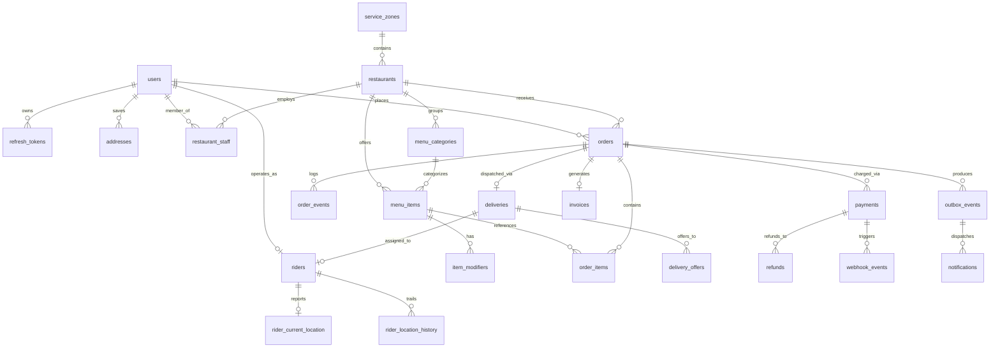

# Complete Platform Entity-Relationship Model (ERD)

**Codename:** Tiffin (KhauGalli)  
**Scope:** Full multi-role platform architecture across all phases (Phase 0 Foundations to Phase 5 Admin & Analytics).

---

## 1. High-Level Entity Relationship Diagram

---

## 2. Table Lifecycle Schedule by Phase

| Table Name | Phase Introduced | Primary Purpose |
| :--- | :--- | :--- |
| `users` | **Phase 0** | Core user identities, phones, roles array, `is_demo` flag |
| `refresh_tokens` | **Phase 0** | Revocable, rotated refresh tokens with expiry tracking |
| `addresses` | **Phase 0** | User saved locations with PostGIS `geography(Point, 4326)` & GIST index |
| `service_zones` | **Phase 0** | Polygons defining active delivery service boundaries |
| `restaurants` | **Phase 0** | Restaurant profiles, single `geography` point, operating hours, status |
| `restaurant_staff` | **Phase 0** | Staff role associations (`OWNER`, `MANAGER`, `KITCHEN`) |
| `menu_categories` | **Phase 0** | Menu category organization with sort order |
| `menu_items` | **Phase 0** | Dishes, prices in integer paise, veg flag, trigram search index |
| `item_modifiers` | **Phase 0** | Customizations, options, extra toppings |
| `orders` | **Phase 2** | Order state machine, item totals, GST, delivery fee, idempotency |
| `order_items` | **Phase 2** | Historical item snapshots, quantities, price at order time |
| `order_events` | **Phase 2** | Immutable audit trail of order state transitions |
| `outbox_events` | **Phase 2** | Transactional outbox pattern for reliable async delivery |
| `payments` | **Phase 2** | Razorpay order and payment IDs, amount in paise, statuses |
| `webhook_events` | **Phase 2** | Raw webhook deduplication by provider event ID |
| `refunds` | **Phase 2** | Idempotent refund entries linked to orders and payments |
| `riders` | **Phase 3** | Delivery partner profiles, vehicle type, KYC status, online state |
| `deliveries` | **Phase 3** | Delivery state machine, pickup/drop geog, customer OTP hash |
| `delivery_offers` | **Phase 3** | 30-second atomic assignment offers with expiry |
| `rider_current_location` | **Phase 3** | Throttled live position in Redis/Postgres with GIST index |
| `rider_location_history` | **Phase 3** | Sampled location trail, partitioned by day |
| `notifications` | **Phase 4** | Delivery status log (WhatsApp, SMS, Email, Push) |
| `notification_templates` | **Phase 4** | DLT/Meta approved templates by channel |
| `invoices` | **Phase 5** | GST-compliant sequential tax invoices (PDF ref) |
| `ledger_entries` | **Phase 5** | Double-entry accounting for commissions, payables, settlements |
| `settlements` | **Phase 5** | Weekly restaurant payouts and statement reconciliation |
| `coupons` & `redemptions` | **Phase 5** | Discount validation and per-user usage caps |
| `ratings` | **Phase 5** | Customer ratings and reviews for orders and restaurants |
| `analytics_events` | **Phase 5** | Append-only event stream, partitioned by month |
| `audit_log` | **Phase 5** | Admin actions audit log |
